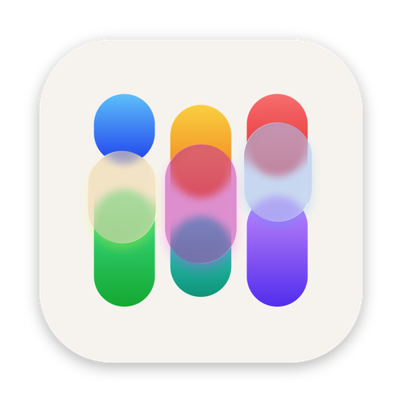

# Daylanes plugin for Claude and Codex



[Daylanes](https://daylanes.app) is a Mac app that tracks consultant time, coding-agent usage and costs per client and project, and keeps a daily project Diary. This plugin connects Claude Code, Claude Cowork, Codex and the ChatGPT desktop app to the Daylanes ledger on your Mac.

**Requires the Daylanes app on macOS.** [Download Daylanes](https://daylanes.app/download), open it once, then install the plugin. The plugin contains no compiled code and downloads nothing. If Daylanes is not installed, its commands stop with a message that says where to get it.

## What it adds

- **Daylanes MCP server** (`daylanes`): read-only tools for status, projects, clients, rules, days and weeks of activity, ledger entries, agent work with no project, hours, tokens and costs, invoice lines and rates. Tools for setting up clients, projects, folder mappings and tracking rules appear only if you start the server with `--access write` (see the main README).
- **`daylanes-diary` skill**: writes or refreshes the Diary entry for a project you set up in **Daylanes → Diary**, following that project's brief. Ask "write my Daylanes diary".
- **`daylanes-time` skill**: answers questions such as "how many hours did I spend on Acme this week?" or "what did my agents cost this month?", with the MCP tools or the command-line tool.

## What it runs

Everything runs locally on your Mac:

- `scripts/daylanes` is a short shell script. It finds Daylanes.app in `/Applications`, in `~/Applications`, at the path in `DAYLANES_APP`, or through Spotlight (`mdfind` for the app's bundle identifier), and runs the command-line tool inside it, `Daylanes.app/Contents/MacOS/TrackerCLI`, with the arguments it was given. The MCP server is `TrackerCLI mcp`.
- The skills ask the agent to run the same `TrackerCLI` commands: `diary list`, `diary guide`, `diary work` and `diary submit` for the Diary, and read-only commands such as `report`, `review` and `billing summary` for questions.
- `TrackerCLI` reads and writes the Daylanes SQLite ledger on your Mac (by default `~/.local/share/tracker/ledger.sqlite3`). It makes no network requests for these commands.

## Data and privacy

The plugin sends nothing to Daylanes or to anyone else. What the agent reads from Daylanes (project names, hours, agent usage, costs, Diary briefs and entries) becomes part of the agent's conversation, and so is sent to your agent's AI provider under that provider's terms. The Diary skill saves only drafts for diaries you set up in Daylanes, and your edits in Daylanes are kept. See the [Daylanes privacy policy](https://daylanes.app/privacy).

## Install

**Claude Code**

```sh
claude plugin marketplace add DomenicoDD/Daylanes
claude plugin install daylanes@daylanes
```

**Codex**

```sh
codex plugin marketplace add DomenicoDD/Daylanes
```

Then install **Daylanes** from the plugin directory in the ChatGPT desktop app or Codex.

**Without the plugin**, register the MCP server directly:

```sh
claude mcp add --scope user --transport stdio daylanes -- /Applications/Daylanes.app/Contents/MacOS/TrackerCLI mcp
codex mcp add daylanes -- /Applications/Daylanes.app/Contents/MacOS/TrackerCLI mcp
```

## Support

Open an issue at https://github.com/DomenicoDD/Daylanes/issues or write to support@daylanes.app. Licensed under MIT, like the rest of Daylanes.
